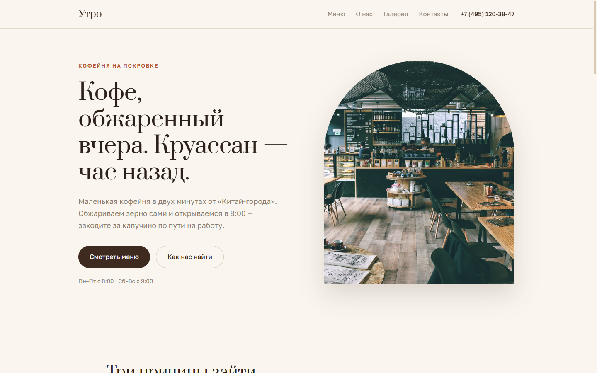

# Утро — лендинг кофейни

Лендинг маленькой кофейни в светлых тонах: тёплая кремовая палитра, типографский прайс-лист с точками-лидерами. Кофейня вымышленная, это концепт для портфолио — но структура, тексты и цены такие, какие получил бы реальный заказчик.

**Живой сайт:** [hmsusbusas-png.github.io/utro-coffee](https://hmsusbusas-png.github.io/utro-coffee/)



## Что внутри

- Сплит-hero с арочным фото — фирменная деталь макета
- Блок «три факта» вместо шаблонных «почему выбирают нас»
- Меню как типографский прайс-лист: две колонки, точки-лидеры между названием и ценой, без карточек
- Галерея со смещённой сеткой, отзывы, акция-стикер
- Контакты с часами работы, телефоном и встроенной Яндекс-картой
- Шрифты Prata и Golos Text с нативной кириллицей, подключены с Google Fonts
- Весь JavaScript — это scroll reveal, файл весит около килобайта

## Как посмотреть

Сборки нет. Достаточно открыть `index.html` в браузере. Если хочется через сервер:

```powershell
# PowerShell, из папки проекта
python -m http.server 8000
# дальше открыть http://localhost:8000
```

## Честно об ограничениях

- Кофейня, адрес и телефон вымышленные, контакты демонстрационные
- Фотографии — стоковые с Unsplash (свободное использование), лежат локально в `assets/img/`
- Яндекс-карта — обычный встраиваемый виджет, своей формы на сайте нет

## Структура

```
utro-coffee/
├── index.html        # вся разметка
├── css/style.css     # стили
├── js/main.js        # scroll reveal, ~1 КБ
├── assets/img/       # фото (Unsplash, свободное использование)
├── screenshots/      # desktop.png, mobile.png
└── favicon.svg
```

## Стек

HTML, CSS и немного ванильного JavaScript. Без фреймворков, без сборки.

---

## EN

Landing page for a fictional coffee shop — a portfolio concept. Light minimalism, warm cream palette, a typographic price list with dot leaders. Vanilla HTML/CSS/JS, no build step: open `index.html` or run `python -m http.server 8000`. Live: https://hmsusbusas-png.github.io/utro-coffee/
