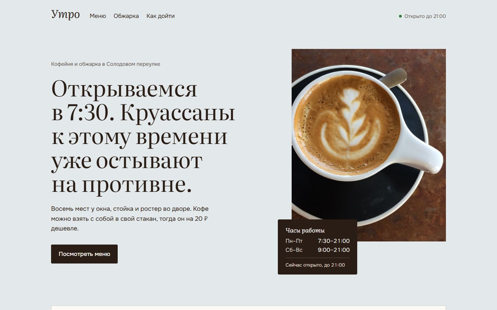
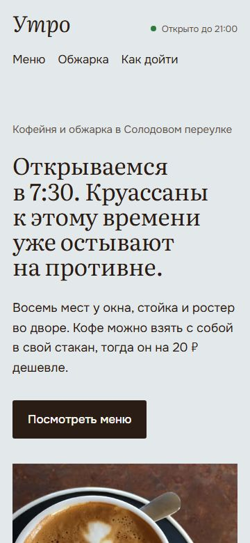

# Утро

Landing page concept for a fictional Moscow coffee shop with its own roastery.

Концепт сайта для вымышленной кофейни «Утро». Главное на странице — меню, свёрстанное как печатный лист у кассы, часы работы с живым статусом «открыто/закрыто» по московскому времени и нарисованная схема квартала вместо виджета карт.

Демо: https://hmsusbusas-png.github.io/utro-coffee/






## Что на странице

- Меню таблицей: объём под названием, цены через косую черту, примечания мелким шрифтом, как в настоящем меню.
- Табличка с часами работы. `js/hours.js` по часам Москвы пишет «Открыто до 21:00» или «Откроемся завтра в 9:00» и обновляется раз в минуту.
- Блок про обжарку: три ложки зерна от светлой до тёмной, у каждой происхождение, вкус и цена пачки.
- Схема квартала в SVG: остановка, маршрут пешком, арка во двор. Улицы придуманы, реальной точки на карте нет.
- Страница 404, Open Graph-картинка, favicon.

## Как запустить

```sh
git clone https://github.com/hmsusbusas-png/utro-coffee
cd utro-coffee
python -m http.server 8000
```

Откройте http://localhost:8000.

## Как устроено

`index.html`, `css/style.css`, `css/fonts.css` и `js/hours.js`. Шрифты: Literata для заголовков и меню, Onest для текста, оба локально в `fonts/` (латиница и кириллица). Фотографии в `img/` в AVIF и WebP трёх ширин.

Lighthouse (мобильный профиль): 100 по всем четырём пунктам. axe и html-validate без ошибок.

## Ограничения

- Кофейни нет. Адрес «Солодовый переулок, 7», часы, меню, цены и почта `zerno@example.com` придуманы.
- Часы работы записаны дважды: в разметке и в `HOURS` в `js/hours.js`. Если меняете одно, поменяйте и другое.

## Фотографии

С Wikimedia Commons, в странице подписаны в подвале.

| Кадр | Автор | Лицензия |
|---|---|---|
| Капучино сверху | [Na bdiaz](https://commons.wikimedia.org/wiki/File:Cappuccino_for_one.JPG) | CC BY-SA 4.0 |
| Капучино на столе | [Vee Satayamas](https://commons.wikimedia.org/wiki/File:A_cup_of_cappuccino.jpg) | CC BY 4.0 |
| Противень с круассанами | [Fumikas Sagisavas](https://commons.wikimedia.org/wiki/File:Freshippo_croissant_bread.jpg) | CC0 |
| Круассан на тарелке | [Andy Li](https://commons.wikimedia.org/wiki/File:Croissant_-_GAIL%27s_2024-08-18.jpg) | CC0 |
| Зерно из ростера | [Jkafader](https://commons.wikimedia.org/wiki/File:Beans_Dropping_from_a_Coffee_Roaster.JPG) | CC BY-SA 3.0 |
| Три степени обжарки | [Michael Allen Smith](https://commons.wikimedia.org/wiki/File:Coffee_Roast_Levels_5_-_The_Home_Roaster_Color_Chart.jpg) (кадры 3, 5 и 7 из серии) | CC BY-SA 2.0 |

## Лицензия

Код — MIT, см. [LICENSE](LICENSE). Фотографии — под лицензиями авторов.
